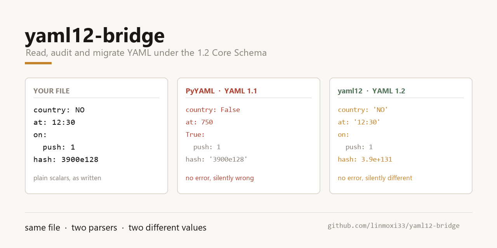

# yaml12-bridge



Read, audit and migrate YAML under the **YAML 1.2 Core Schema**, on top of PyYAML.

PyYAML is a YAML **1.1** parser. It will stay one: the maintainers have said
that defaulting to 1.2 "would break a lot of stuff", and the 1.2 schema work has
been sitting in an unmerged PR since 2021. That is a reasonable call for a
library with 900M downloads a month, but it leaves a real gap for anyone whose
YAML crosses into a 1.2 parser -- kubectl, Node, Go, Rust, Docker Compose.

This package is the opt-in at the call site: same scanner, same error messages,
1.2 scalar semantics, plus a migration tool for files that already exist.

```
pip install yaml12-bridge        # not published; see "Install" below
```

## The problem, in four lines

```python
>>> import yaml
>>> yaml.safe_load("country: NO")
{'country': False}                     # the string "NO" became False

>>> yaml.safe_load("at: 12:30")
{'at': 750}                            # a time became 750 seconds

>>> yaml.safe_load("on:\n  push: 1")
{True: {'push': 1}}                    # a CI trigger key became True
```

None of these raise. All three are silently wrong for the author, and the first
one is the classic "Norway problem". YAML 1.2 fixed the spec; PyYAML never
followed, because following would break existing code.

## What this does about it

```python
>>> import yaml12bridge
>>> yaml12bridge.load("country: NO")
{'country': 'NO'}

>>> yaml12bridge.load("at: 12:30")
{'at': '12:30'}

>>> yaml12bridge.load("on:\n  push: 1")
{'on': {'push': 1}}
```

And for files that already exist, a migration tool that **does not re-serialise**
-- so comments, anchors, key order, block scalars and quoting style all survive:

```console
$ yaml12 migrate .github/workflows/ci.yml --show-diff
.github/workflows/ci.yml: 6 scalar(s) rewritten (to_1_2, text)
  line 3:1  on (key)
      True -> 'on'   (text 'on')
  line 9:12  env.DEBUG
      False -> 'off'   (text 'off')
  ...
--- a/ci.yml
+++ b/ci.yml
@@ -3,1 +3,1 @@
-on:
+'on':
```

## The part that matters: there are two correct answers

`country: NO` can be pinned two ways, and they are **not** interchangeable:

| intent | mode | result | what survives |
|---|---|---|---|
| `NO` is a country code | `--mode text` (default) | `country: 'NO'` | the characters |
| the flag was meant to be false | `--mode value` | `country: false` | the boolean |

Only the author knows which. A country code wants the text; a feature flag wants
the boolean. So both exist, and the report tells you which values disagree before
you commit:

```console
$ yaml12 migrate k8s.yml --mode value
k8s.yml: 7 scalar(s) rewritten (to_1_2, value)
  line 12:18  metadata.annotations.build/hash
      '3900e128' -> '3900e128'   (text '3900e128')
  line 26:21  ...resources.limits.cpu
      1000.0 -> 1000.0   (text '1e3')
  line 41:25  ...configMap.defaultMode
      420 -> 420   (text '0644')  [check: numeric re-read]
```

`[check: numeric re-read]` marks the nastiest class: `0644` is **int in both**
schemas but means 420 in 1.1 and 644 in 1.2. Same tag, different number, no error
anywhere. Quoting preserves the text; rewriting preserves the number; you decide.

## Commands

```console
yaml12 check   files...              # parse with 1.2, fail on duplicate keys
yaml12 diff    files...              # show what changes meaning, write nothing
yaml12 migrate files... [--mode text|value] [--in-place] [--show-diff]
yaml12 migrate files... --check      # CI gate: exit 1 if migration is needed
yaml12 explain 'NO'                  # what one scalar means in each schema
yaml12 roundtrip files...            # prove load -> dump -> load is lossless
```

All commands accept files, directories or globs, and exit non-zero on a real
problem.

## Install

Not on PyPI. From a checkout:

```console
pip install -e .
```

Requires Python 3.9+ and PyYAML 5.4+. `libyaml` is used when available and is
about 5x faster; the pure-Python path is behaviourally identical and is tested
against the C path on every run.

## What it costs

Measured on 12 real files (40 KB) and a synthetic 636 KB / 40,000-key document:

| loader | corpus | 40k keys |
|---|---|---|
| PyYAML 1.1, pure Python | 55.8 ms | 1261 ms |
| PyYAML 1.1, libyaml | 6.4 ms | 335 ms |
| **yaml12, libyaml** | **7.6 ms** | **337 ms** |
| yaml12, pure Python | 54.8 ms | -- |

The honest comparison is against PyYAML-on-libyaml: the schema layer costs
roughly **1-15%** on real files and is within noise on large ones. The apparent
5x win against `yaml.safe_load` is libyaml, not us -- `safe_load` uses the pure
Python loader.

## Conformance, and where implementations disagree

The 1.2 Core Schema is not implemented identically everywhere. Tested against
ruamel.yaml 0.19.1, js-yaml 4.x and the `yaml` npm package:

| scalar | PyYAML 1.1 | yaml12 | ruamel 1.2 | js-yaml 4 | `yaml` npm |
|---|---|---|---|---|---|
| `NO` | `False` | `'NO'` | `'NO'` | `'NO'` | `'NO'` |
| `12:30` | `750` | `'12:30'` | `'12:30'` | `'12:30'` | `'12:30'` |
| `0644` | `420` | `644` | `644` | `644` | `644` |
| `1e3` | `'1e3'` | `1000.0` | `1000.0` | `1000.0` | `1000.0` |
| `1_000` | `1000` | `'1_000'` | `1000` | `'1_000'` | `'1_000'` |
| `2001-12-14` | `date` | `'2001-12-14'` | `date` | `'2001-12-14'` | `'2001-12-14'` |

Two of those rows are genuine spec gaps rather than mistakes on anyone's part:

* **`1_000`** — the 1.2 Core Schema does not allow underscore separators.
  ruamel accepts them anyway for 1.1 compatibility. This package follows the
  spec; `--mode value` will quote such a scalar, which is the safe direction.
* **timestamps** — the 1.2 Core Schema has **no timestamp type**, so
  `2001-12-14` is a string. ruamel and PyYAML construct a `date` anyway. This
  package defaults to the spec (string) and offers
  `LoaderOptions(timestamps=True)` for PyYAML-compatible behaviour.

Full matrix and methodology: [`docs/CONFORMANCE.md`](docs/CONFORMANCE.md).

## Scope and limits

**Does:** scalar resolution (null/bool/int/float/str), duplicate-key detection,
`%YAML` directive mismatch warnings, 1.2-aware dumping, and offset-precise
migration of existing files.

**Does not:** change the grammar. Block scalars, anchors, aliases, merge keys and
flow style are PyYAML's and are unchanged -- including `<<`, which is preserved
bare because quoting it would silently turn a merge into a literal key.

**Known limits:**

* `mode=value` on a numeric scalar is a judgement call the tool cannot make for
  you. It reports `[check: numeric re-read]` and leaves the decision visible.
* Keys are always pinned as text, never rewritten by value. Rewriting `on:` to
  `true:` would produce a workflow no engine can read.
* The migration splices at byte offsets reported by PyYAML's marks and verifies
  each slice before touching it; if a future PyYAML changes mark semantics it
  raises rather than corrupting the file.
* Multi-document streams are migrated document by document, but `check` and
  `roundtrip` parse a single document at a time.

## Samples

`samples/` holds four realistic configs written the way people actually write
them -- a GitHub Actions workflow, a Kubernetes Deployment, an Ansible playbook
and a Compose file -- plus a Playwright snapshot taken from a real browser
session. They are the input to `examples/demo.py` and to the cross-implementation
check.

`samples/migrated/` holds the same files after `yaml12 migrate --mode value`.
Their 1.2 reading equals the original's 1.1 reading, which is what the CI gate in
`.github/workflows/migrate-gate.yml` asserts.

## Tests

```console
pytest -q                              # 238 tests
python bench/crosscheck.py             # needs `npm i yaml` in bench/
```

The cross-implementation check is the one that matters: it reads the original
with **PyYAML** (1.1) and the migrated file with the **`yaml` npm package**
(1.2), in different languages, and requires the values to match. On the four
sample configs it compares 108 scalars with zero mismatches.

The corpus in `tests/corpus/` is 12 Playwright accessibility snapshots from a
real browser session -- deep nesting, Unicode, bracket-heavy keys, and one music
player whose `4:56` durations PyYAML reads as 296. That last one is the tool
working, not a bug.

## License

MIT.
